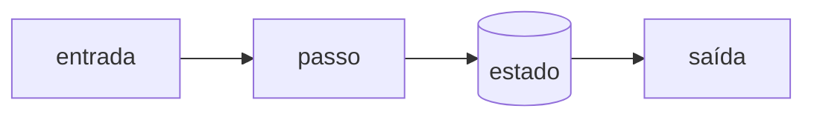
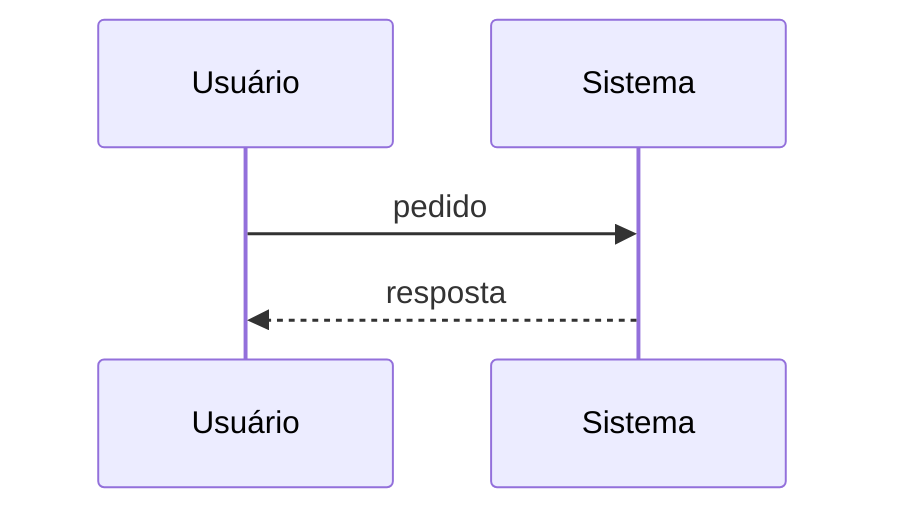

<div align="center">

# nome-do-projeto

**Uma frase: o que é e para quem.**<br />
Segunda linha: a garantia que o projeto dá.

[](https://github.com/USER/REPO/actions/workflows/ci.yml)

[](LICENSE)

[Why](#why) · [See it](#see-it) · [Run it](#run-it) · [How it works](#how-it-works) · [The trap](#the-trap) · [Limits](#what-this-is-not)


</div>

---

## Why

O problema em 3 a 5 linhas, depois a ideia.



> Uma frase de destaque: o que o leitor deve guardar.

---

## See it

Cenário concreto.

```
$ comando real
saída real colada, não descrita
```

<details>
<summary><b>Caso de borda</b></summary>

```
$ outro comando
```

</details>

---

## Run it

```bash
git clone https://github.com/USER/REPO && cd REPO
pip install -e ".[dev]"
pytest -q
```

---

## How it works

| Arquivo | Papel |
|---|---|
| `src/a.py` | o que mora aqui |
| `src/b.py` | o que mora aqui |

```python
# trecho mínimo que mostra a ideia central
```



---

## The trap

> [!WARNING]
> A armadilha que quem usa vai pisar, e como evitar.

---

## What this is not

| Não está aqui | Detalhe |
|---|---|
| Recurso X | por que ficou de fora |
| Recurso Y | limite conhecido |
